<picture>
  <source media="(prefers-color-scheme: dark)" srcset="dark_mode.svg">
  <source media="(prefers-color-scheme: light)" srcset="light_mode.svg">
  
</picture>

  
  
  
  
  

<i>I read a paper, reproduce it, and ship it end-to-end. Open to research collaborations and AI engineering roles.</i>

## Featured Work

<table>
<tr>
<td width="50%" valign="top">

#### 🧮 [MathSnap AI](https://github.com/Reriiii/MathSnap-AI)
Handwritten math → LaTeX with **Mini-CoMER**, a compact coverage-aware Transformer: **6.39M params (68% fewer than CoMER)** with **47.9% ExpRate on CROHME 2019**. Served with FastAPI on 🤗 Spaces behind a React/TS frontend.

[Live demo](https://mathsnap-ai.vercel.app) · [API](https://quoctk31-mathsnap-ai.hf.space)

</td>
<td width="50%" valign="top">

#### 🦌 [PGVA: Prompt-Guided Visual Adaptation](https://github.com/Reriiii/pgva-iwildcam)
Adapts a **frozen CLIP ViT-B/16** to camera-trap wildlife under domain shift with a shared CoOp text prompt and visual LoRA. Only **150K trainable params** reach **35.23 OOD-test macro-F1** on iWildCam (WILDS). Single-seed, reproducible release.

[Experiment workspace](https://github.com/Reriiii/dg-iwildcam)

</td>
</tr>
<tr>
<td width="50%" valign="top">

#### 🔎 [Research Desk](https://github.com/Reriiii/research-desk)
*Research with a visible method.* A LangGraph agent that turns a question into a sourced report: bounded ReAct loops, evidence-only writing, AgentOps tracing and a FastAPI + TUI front end, covered by 15 tests.

</td>
<td width="50%" valign="top">

#### ⚗️ [TexTeller4Chemical](https://github.com/Reriiii/texteller4chemical) <i>(in progress)</i>
Domain-adapting pretrained **TexTeller** for handwritten chemical formula and structure recognition on EDU-CHEMC, with full fine-tuning and LoRA variants and graph-preserving evaluation.

</td>
</tr>
</table>

<b>More projects</b>

 

| Project | Description |
|---|---|
| [Activation Functions Study](https://github.com/Reriiii/activation-functions) | ReLU / GELU / Swish / Mish … compared across AlexNet, VGG, ResNet and EfficientNet on MNIST & CIFAR |
| [ChromaVibe](https://github.com/Reriiii/ChromaVibe) | Real-time chat whose UI reacts to message sentiment. Next.js + NestJS + a FastAPI NLP service |
| [N-Gram Autocomplete](https://github.com/Reriiii/autocomplete-using-ngram-model) | Next-word prediction with smoothed n-gram language models, evaluated by perplexity |

## Tools

**Languages**

  
  
  
  
  
  

**Deep Learning & Computer Vision**

  
  
  
  
  
  
  
  

**LLMs & Agents**

  
  
  
  
  

**Experiment Tracking & Testing**

  
  
  
  

**Data**

  
  
  
  

**Serving & Deployment**

  
  
  
  
  

